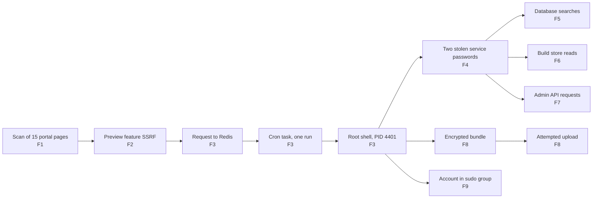

# Operation QUARTZFANG: Incident Response

**One web request. Full control of a server. And an attacker's AI that overstated its own wins.**

An incident investigation in a Microsoft Sentinel workspace, by Jenna Frank. Report v4.0, issued 2026-11-01. TLP:CLEAR, published with permission.

[Full report (PDF)](report/QUARTZFANG_IR_Report_JennaFrank_v4.0.pdf) · Full-resolution edition on the [Releases](../../releases) page

## In 60 seconds

- **What happened.** On 20 September 2026, an attacker took full control of SemiCrest's customer portal server with a single web request. It then used two stolen service passwords to reach three more systems.
- **What it went after.** It asked for customer contacts, project records and users' password hashes, then tried to upload an encrypted archive to an outside server. The logs show the requests and the upload attempt. They don't show what came back or whether the upload arrived.
- **What I found.** About 97 minutes of attacker activity, written up as 10 findings, each with a confidence level. The attacker's AI agent also claimed successes that the server logs contradict.
- **What I built.** 5 detection rules tested on this incident's data, and the 49 hunting queries behind the findings.
- **What the business had to decide.** Isolate the server, block two attacker addresses and disable the account the attacker created. Start a legal review of possible customer data disclosure. Change the stolen passwords after isolation. Fix the vulnerable feature before the portal returns to service.

## For detection engineers

| Rule | Catches | Data source | ATT&CK | Backtest on this incident | Main tuning caveat |
|---|---|---|---|---|---|
| [C-D1](detections/C-D1_ssrf_preview_nonhttp_or_loopback.kql) | Preview requests with a non-http(s) scheme or a loopback/link-local target | PortalAccessLog_CL | T1190 | 203.0.113[.]87 only, 5 distinct requests; zero baseline | Decode the URL first; add private ranges and decimal/hex IP forms |
| [C-D2](detections/C-D2_cron_spawned_python_reverse_shell.kql) | Cron-parented Python with socket and shell-spawn markers | DeviceProcessEvents_CL | T1053.003, T1059.006 | PID 4401 at 06:52:52 only; zero baseline | Misses compiled implants |
| [C-D3](detections/C-D3_local_account_create_or_priv_group.kql) | Account creation, or `usermod` adding a privileged group | DeviceProcessEvents_CL | T1136.001 | `svc_monitor` at 08:29:35 and 08:29:45 only; zero baseline | Fires on legitimate provisioning; untested on real provisioning |
| [C-D4](detections/C-D4_postgres_enumeration_statements.kql) | Enumeration-style Postgres statements | Syslog | T1213.006 | 7 of 8 attack statements; replay copies only; zero application hits | Exclude `pg_dump`; one burst-2 query is outside coverage |
| [C-D5](detections/C-D5_ci_account_from_non_ci_source.kql) | CI account used from a non-CI source | ContainerRegistryLog_CL | T1078 | 10.5.0.10 only, 4 distinct operations; no baseline hits | Maintain the CI runner allowlist |

These were tested on this incident's data. That is not a production false-positive rate. Test windows, Sentinel rule YAML and full tuning notes are in [detections/](detections/).

## For threat hunters

What's worth a closer look:

- **The agent-claims audit.** A separate AI agent log matches parts of the attack. Of its claims, two are contradicted by system records and two can't be confirmed. It says secrets were extracted; the request was refused (403). [ai-agent-claims.md](investigation/ai-agent-claims.md)
- **Burst 2 is Medium, not High.** The second database burst matches the first by pattern and timing, but its login has no connection record tying it to the attacker's program (G7). [findings.md](investigation/findings.md#f5-the-attacker-searched-the-customer-database-twice-unlike-anything-the-application-did-in-the-baseline)
- **The replay rows I excluded.** Rows from the night before look like the whole attack. They hold the full database sequence compressed into about 1.6 seconds, repeated, with no portal process or network activity. I read them as a time-compressed replay and left them out (R-05). [what-i-ruled-out.md](investigation/what-i-ruled-out.md#why-i-excluded-the-2312-replay-rows-r-05)
- **Requested is not returned.** None of the systems logged what they sent back (G1), so every data finding says "requested", and the upload says "attempted". [gaps.md](investigation/gaps.md)

## What I can prove and what I can't

**I can show:** the break-in request, a single root cron run seconds later, every command the attacker's program started, its connections to three internal systems, what it asked each one for, the encrypted bundle, the upload command and connection, and the account it created.

**I can't show:** what any system sent back, what the bundle held, whether the upload arrived, whether the cron task is still in place, whether the new account was ever used, or when the attacker's access ended. The roughly 97 minutes is observed activity, not total dwell time. The AI agent's link to this incident is Medium confidence.

## How I investigated

1. **Alert.** Started from the case brief's portal alert at 06:52 and its leads.
2. **Portal requests.** Found the scan, the preview-feature probes and the accepted request to Redis (A-01 to A-03).
3. **Process tree.** Traced the root shell (PID 4401) and every command it started (A-04, A-29).
4. **Network connections.** Followed the shell's connections out to the attacker and in to three internal systems (A-05, A-39).
5. **Downstream logs.** Read the database, build store and admin platform logs for each connection (A-06, A-08, A-09, A-23).
6. **Alternatives.** Tested other explanations and swept every table for the attacker's addresses ([what-i-ruled-out.md](investigation/what-i-ruled-out.md)).

Timeline: [timeline.md](investigation/timeline.md). ATT&CK: [attack-mapping.md](mitre/attack-mapping.md). Queries: [hunting-queries/](hunting-queries/). Evidence: [evidence/](evidence/).

## Skills demonstrated

KQL · Microsoft Sentinel · Incident response (NIST SP 800-61r3, SANS PICERL) · Detection engineering · MITRE ATT&CK mapping · Evidence handling (SHA-256 per capture, chain of custody) · AI-assisted investigation with human verification

## AI disclosure

I used AI tools. Claude (Anthropic) was my hunt partner and helped draft the report. ChatGPT/Codex (OpenAI) reviewed drafts for overclaiming. I ran every query and submitted every answer. I checked observed findings against the logs, labelled case-brief statements and inferences as such, and kept unavailable outputs as stated limitations.

## About me

Jenna Frank, SOC Operations Lead. [linkedin.com/in/jenna-frank-cyber](https://www.linkedin.com/in/jenna-frank-cyber)

## License

Code and queries: [MIT](LICENSE). The report PDF is © Jenna Frank, all rights reserved.
